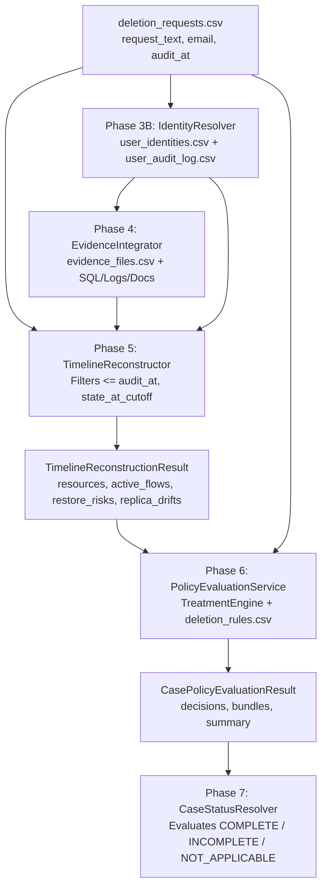

# Phase 7 — Chunk 7.1 Discovery and Interface Contract Report
## Case Status Resolver: Architecture, Data Flows, and Contract Specification

**Date:** 2026-10-25  
**Auditor / Architect:** Senior Forensic AI Systems Engineer & Principal Architect  
**Harness:** Antigravity IDE  
**Model:** Gemini 3.8 Flash (Medium)  
**Target Repository:** HackerRank Orchestrate (October 2026) — *Ghost Data Still Exists*  
**Scope:** Discovery, pipeline tracing, interface inventory, and planning for Phase 7 (Case Status Resolver). Implementation deferred to Chunk 7.2.

---

### 1. Executive Summary & Objective

Phase 7 is responsible for determining the macro-level **`deletion_status`** for each audit request:
$$\text{deletion\_status} \in \{\text{"COMPLETE"}, \text{"INCOMPLETE"}, \text{"NOT\_APPLICABLE"}\}$$

This discovery audit surveyed the repository's existing pipeline (Phase 3B Identity Resolution, Phase 4 Evidence Collection, Phase 5 Timeline Reconstruction, Phase 6 Policy Evaluation) to establish:
1. Which exact fields prove that deletion was authorized or requested.
2. The end-to-end data flow that transforms a raw CSV row into typed resource decisions.
3. The exact boundaries between Phase 6 policy evaluation, Phase 7 case status resolution, and Phase 8 remediation planning.
4. The consumption contract and target directory layout for Phase 7.

---

### 2. Deletion Request Schema & Authorization Analysis

#### 2.1 Request Schema (`dataset/deletion_requests.csv`)
Each row conforms to the 7-field header:
```csv
case_id,email,requested_at,reported_status,reported_at,audit_at,request_text
```

| Field | Type | Semantic Meaning & Challenge Contract |
|---|---|---|
| `case_id` | `str` | Unique case identifier (e.g. `case_01`, `case_533`). |
| `email` | `str` | Requester email address; may be current or historical identifier. |
| `requested_at` | `ISO-8601` | Timestamp when user submitted request. |
| `reported_status` | `str` | Workflow claim (`COMPLETE`, `PARTIALLY_COMPLETE`, `NOT_STARTED`). **Never accepted as proof.** |
| `reported_at` | `ISO-8601` | Timestamp when workflow status was claimed. |
| `audit_at` | `ISO-8601` | Strict temporal cutoff. Evidence captured after this time is excluded. |
| `request_text` | `str` | Free-text user message. **The sole authoritative field proving whether deletion was requested.** |

#### 2.2 Proof of Deletion Authorization
- **Authoritative Source:** `request_text`.
- **Governing Rule (`AGENTS.md` §6.5):**
  > "First determine whether `request_text` authorizes deletion. A request for access, correction, export, marketing opt-out, or another non-deletion action is `NOT_APPLICABLE`, even if other fields resemble a deletion case."
- **Non-Deletion Categories Identified in Dataset:**
  - **Account Rectification / Update:** (e.g., `case_533`: "The mobile number on my profile is out of date. Please replace it with the new one and leave the account active.")
  - **Marketing Opt-Out:** (e.g., `case_534`: "Please stop the promotional emails. I still need the account and my order history, so I am not asking for deletion.")
  - **Data Portability / Export:** (e.g., `case_535`: "I'd like to download my account information in a portable format. Please keep the account as it is.")
  - **Support / Login Help:** (e.g., `case_536`: "I can't access my profile and need help resetting the login. Do not close the account.")
  - **Subject Access Request (SAR):** (e.g., `case_539`: "Can you tell me what personal information you hold about me? This is an information request, not a request to erase it.")
  - **Invoice Copy:** (e.g., `case_540`: "I need a copy of last year's invoices for my records. Please leave my profile and purchase history in place.")
- **Upstream Pattern Detection:** `code/timeline/reconstructor.py` already includes regex matcher `is_non_deletion_text(text: str) -> bool` and sets `is_non_deletion_request: bool` on `TimelineReconstructionResult`.

---

### 3. End-to-End Data Flow: Request to Policy Result



1. **Identity Resolution (Phase 3B):** `IdentityResolver` resolves `email` $\to$ `user_id` and all current/historical identifiers (`email`, `phone`, `email_hash`).
2. **Evidence Collection (Phase 4):** `EvidenceIntegrator` scans databases, logs, search records, exports, documents, and screenshots for any sighting of resolved identifiers.
3. **Timeline Reconstruction (Phase 5):** `TimelineReconstructor` builds chronological events per resource up to `audit_at`, identifies state transitions (`ABSENT`, `PRESENT`, `REDACTED`, `ANONYMIZED`, `ACTIVE`, `BLOCKED`), checks replica drift, active sync flows, and restore risks.
4. **Policy Evaluation (Phase 6):** `PolicyEvaluationService` applies `deletion_rules.csv` to each resource via `TreatmentEngine`, verifying tombstones, retention windows, and sensitive field restrictions, emitting typed `CasePolicyEvaluationResult`.

---

### 4. Existing Case-Status Logic Inventory

- **Survey Results:** No case-level status resolver currently exists in the repository.
- **Intentional Boundary Checks:**
  - `code/timeline/test_reconstructor.py` explicitly tests: `self.assertFalse(hasattr(res, "deletion_status"))`.
  - `code/policy/service.py` deliberately returns resource-level decisions without declaring case-level verdicts.
  - `code/main.py` and `code/evaluation/main.py` are empty starter placeholders (0 bytes).
- **Conclusion:** Phase 7 has a completely clean slate and must implement the official Case Status Resolver without legacy constraints or conflicting code.

---

### 5. Case Status Contract & Decision Semantics

Per `problem_statement.md` and `AGENTS.md` §6.3 & §6.5:

#### 5.1 `NOT_APPLICABLE`
- **Definition:** The user did not authorize deletion.
- **Conditions:**
  - `request_text` contains non-deletion phrases (SAR, marketing opt-out, data export, rectification, help).
  - `is_non_deletion_request == True`.
- **Downstream Consequence:** In Phase 8/9, `steps_json` must serialize to `[]` (`case_id,NOT_APPLICABLE,[]`).

#### 5.2 `INCOMPLETE`
- **Definition:** Deletion was authorized, but one or more policy violations, recreation risks, or unverified states remain at `audit_at`.
- **Conditions (any of the following):**
  1. Any resource decision has `compliance_result == NON_COMPLIANT`.
  2. Any resource decision has `compliance_result == INDETERMINATE`.
  3. Any active data flow is `ACTIVE` (can copy or recreate user data).
  4. Any restore risk is `ACTIVE` (backup archive restore access is not blocked).
  5. Any confirmed replica drift exists (primary deleted, replica still present).
  6. Pre-cutoff recreation occurred.
  7. A required retained record is missing or expired prematurely.
  8. Unresolved contradictions or upstream resolution errors (`AMBIGUOUS` or `UNRESOLVED` identity).

#### 5.3 `COMPLETE`
- **Definition:** Deletion was authorized and fully compliant across every system and copy at `audit_at`.
- **Conditions (all must be satisfied simultaneously):**
  1. `is_non_deletion_request == False`.
  2. Every discovered resource is `COMPLIANT`.
  3. Prohibited records are confirmed `ABSENT`.
  4. Redacted records (e.g. tombstones, support messages) have all direct PII removed and stable reference intact.
  5. Anonymized records are completely unlinked from user identifiers.
  6. All policy-required retained records remain `PRESENT` within their retention period.
  7. All data flows are `DISABLED`.
  8. All backup archives have restore access `BLOCKED`.
  9. Zero replica drift, zero pre-cutoff recreation, zero active risks.
  10. Zero unresolved contradictions.
  11. Every compliant state is substantiated by admissible participant-visible evidence (`evidence_id` $\ne$ `""`).

---

### 6. Phase 7 Interface Specification

#### 6.1 Proposed Module Location
- Package: `code/status/`
  - `code/status/__init__.py`
  - `code/status/models.py` (Typed data classes: `DeletionStatus`, `CaseStatusResult`)
  - `code/status/resolver.py` (`CaseStatusResolver`)
  - `code/status/test_resolver.py` (Unit tests)
  - `code/status/test_scenarios.py` (Integration & representative scenario tests)

#### 6.2 Typed Output Contract (`CaseStatusResult`)
```python
@dataclass(frozen=True)
class CaseStatusResult:
    case_id: str
    deletion_status: str              # "COMPLETE" | "INCOMPLETE" | "NOT_APPLICABLE"
    reason: str                       # Concise forensic explanation
    is_non_deletion_request: bool     # True if request_text did not authorize deletion
    resolution_status: str            # "RESOLVED" | "AMBIGUOUS" | "UNRESOLVED"
    non_compliant_resources: list[str]
    indeterminate_resources: list[str]
    active_flows: list[str]
    restore_risks: list[str]
    replica_drifts: list[str]
    upstream_errors: list[str]
    contradictions: list[str]
    evidence_backed_checks: list[str]
    summary: dict
    diagnostics: list[str] = field(default_factory=list)
```

#### 6.3 Public Resolver Interface
```python
class CaseStatusResolver:
    def resolve_status(
        self,
        request: dict,
        policy_result: CasePolicyEvaluationResult,
        timeline_result: Optional[TimelineReconstructionResult] = None,
        context: Optional[dict] = None,
    ) -> CaseStatusResult:
        ...
```

---

### 7. Identified Risks & Forensic Guardrails

1. **False Complete Risk:** If an active data flow or restore risk is ignored, a case that reports `reported_status="COMPLETE"` might be falsely classified as `COMPLETE`.
   * *Guardrail:* Status resolver must verify `active_data_flows`, `restore_risks`, and `replica_drift_findings` directly from `CasePolicyEvaluationResult`.
2. **Missing Retained Record:** If a `SECURITY_AUDIT_LOG` or `LEGAL_HOLD_RECORD` is missing, the workflow might claim deletion complete, but policy requires retention.
   * *Guardrail:* A missing retained record yields `compliance_result=NON_COMPLIANT`, forcing `deletion_status=INCOMPLETE`.
3. **Multi-lingual Request Texts:** `request_text` contains messages in English, Spanish, French, etc.
   * *Guardrail:* The non-deletion text analyzer must be comprehensive, or check upstream `is_non_deletion_request` while also checking explicit cancellation phrases.
4. **Admissible Evidence Absence:** In a `COMPLETE` case, all verifications must cite admissible evidence. If evidence is missing, state cannot be proven.
   * *Guardrail:* A resource with unknown or unevidenced state is marked `INDETERMINATE`, preventing `COMPLETE`.

---

### 8. Phase 7 10-Chunk Implementation Plan

- **Chunk 7.1:** Repository Discovery and Interface Contract (**Complete with this report**).
- **Chunk 7.2:** Case Status Data Models and Typed Enums (`DeletionStatus`, `CaseStatusResult`).
- **Chunk 7.3:** Deletion Authorization & Non-Deletion Request Classifier (`NOT_APPLICABLE` engine).
- **Chunk 7.4:** Violation & Risk Aggregation Engine (Surfacing non-compliance, active flows, restore risks, replica drifts).
- **Chunk 7.5:** Strict `COMPLETE` Decision Engine (Full compliance, retention verification, evidence citations).
- **Chunk 7.6:** Diagnostic Reason Generator & Failure Explainer (Human-readable forensic justification for status).
- **Chunk 7.7:** Integration Service Boundary (Consuming Phase 5 & 6 outputs directly).
- **Chunk 7.8:** Unit & Edge-Case Test Suite (Ambiguities, contradictions, missing files, empty resources).
- **Chunk 7.9:** End-to-End Pipeline Validation against 32 Sample Cases (`sample_output.csv`).
- **Chunk 7.10:** Forensic Audit Report and Phase 7 Sign-Off.

---

### 9. Completion Gate Sign-Off

- [x] All upstream interfaces (Phase 3B, Phase 4, Phase 5, Phase 6) inspected and documented.
- [x] Exact schema and authoritative field (`request_text`) for deletion authorization established.
- [x] Absence of existing case status logic confirmed.
- [x] Strict input and output contracts defined.
- [x] 10-chunk implementation plan established.

**Status:** `CHUNK 7.1 COMPLETE — READY FOR CHUNK 7.2`
