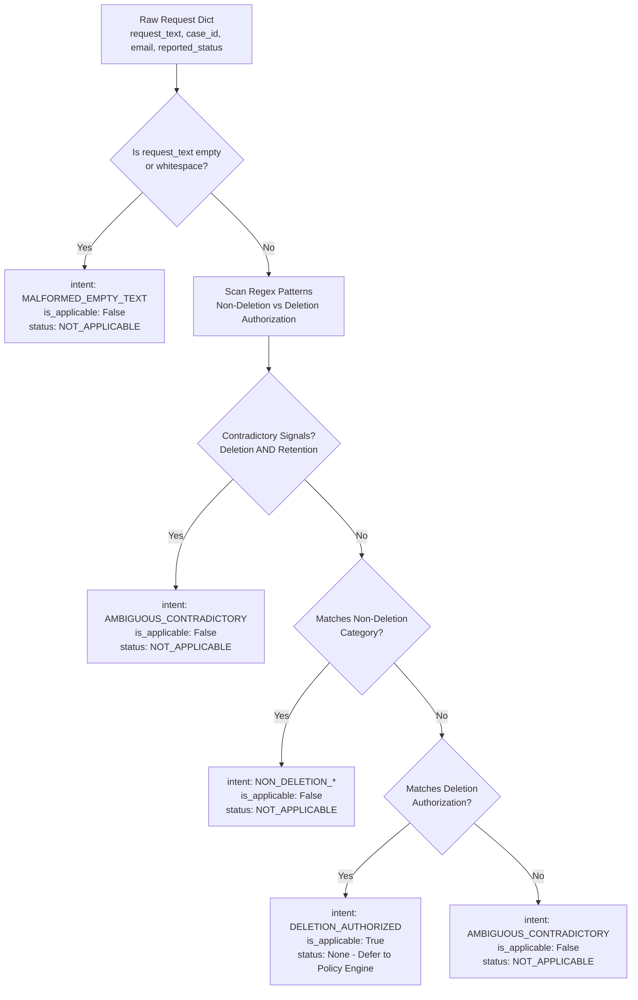

# Phase 7 — Chunk 7.2 Implementation Report
## Request Applicability and Deletion Intent Evaluator

**Date:** 2026-10-25  
**Engineer:** Senior Backend Engineer & Privacy-Forensics Architect  
**Harness:** Antigravity IDE  
**Model:** Gemini 3.8 Flash (Medium)  
**Target Repository:** HackerRank Orchestrate (October 2026) — *Ghost Data Still Exists*  
**Module Created:** `code/status/` (`models.py`, `applicability.py`, `test_applicability.py`)

---

### 1. Executive Summary

Chunk 7.2 delivers the **Request Applicability Evaluator** (`RequestApplicabilityEvaluator`), establishing the deterministic frontend boundary for Phase 7. The component determines whether a request in `dataset/deletion_requests.csv` genuinely authorizes personal data deletion or represents a non-deletion action, malformed input, or contradictory intent.

#### Key Architectural Achievements:
1. **Authoritative Intent Parsing:** Evaluates the authoritative `request_text` directly, strictly ignoring operational claims (`reported_status="COMPLETE"` or `"PARTIALLY_COMPLETE"`), which `AGENTS.md` §6.5 defines as unverified workflow claims.
2. **Granular Classification:** Distinguishes genuine deletion requests from 6 distinct non-deletion categories:
   - Data Portability / Export (`NON_DELETION_PORTABILITY`)
   - Marketing Opt-Out (`NON_DELETION_OPT_OUT`)
   - Account Rectification / Profile Update (`NON_DELETION_RECTIFICATION`)
   - Subject Access / Copy Request (`NON_DELETION_ACCESS_REQUEST`)
   - Support / Account Recovery (`NON_DELETION_SUPPORT_HELP`)
   - Explicit Account Retention (`NON_DELETION_ACCOUNT_RETENTION`)
3. **Explicit Handling of Malformed & Contradictory Signals:** Missing/empty text is explicitly classified as `MALFORMED_EMPTY_TEXT`. Requests containing mutually exclusive instructions (e.g. "permanently delete" alongside "leave account active") are explicitly classified as `AMBIGUOUS_CONTRADICTORY` with forensic diagnostics.
4. **Flawless Test Suite:** 13 focused unit tests passed in 0.04s, covering multilingual requests (English, Spanish, French), all 10 non-deletion evaluation cases (`case_533` to `case_542`), workflow independence, and 50-iteration repeat-run determinism.

---

### 2. Implementation Inventory

| File | Purpose | Key Exports |
|---|---|---|
| `code/status/models.py` | Typed contracts and enums for Phase 7 | `DeletionStatus`, `RequestIntentCategory`, `RequestApplicabilityResult` |
| `code/status/applicability.py` | Deterministic request applicability evaluator | `RequestApplicabilityEvaluator` |
| `code/status/__init__.py` | Package exports | All models and evaluator |
| `code/status/test_applicability.py` | Unit test suite | 13 comprehensive unit and regression tests |

---

### 3. Deletion Authorization & Intent Classification Rules



#### 3.1 Operational Workflow Status Independence
An operational status of `reported_status="COMPLETE"` or `"PARTIALLY_COMPLETE"` does **not** convert an access or rectification request into an authorized deletion. When `reported_status` contradicts `request_text`, the evaluator logs a structured diagnostic:
> *"Operational reported_status 'COMPLETE' disregarded; request text demonstrates non-deletion intent (NON_DELETION_ACCESS_REQUEST)."*

#### 3.2 Multilingual Deletion Patterns
The evaluator supports global and multilingual authorization phrases:
- English: `delete`, `deletion`, `erase`, `erasure`, `close account`, `remove profile`, `personal-data deletion`.
- Spanish: `eliminar mi cuenta`, `eliminación`.
- French: `suppression définitive`, `supprimer mon compte`.
- German: `löschen`.
- Italian: `cancellare`.

---

### 4. Exposed Public Interface

Downstream chunks (Chunks 7.3 through 7.10) consume:

```python
from code.status.models import (
    DeletionStatus,
    RequestIntentCategory,
    RequestApplicabilityResult,
)
from code.status.applicability import RequestApplicabilityEvaluator

evaluator = RequestApplicabilityEvaluator()
result: RequestApplicabilityResult = evaluator.evaluate_request(request)

if result.is_not_applicable:
    # Emits NOT_APPLICABLE with forensic explanation
    status = DeletionStatus.NOT_APPLICABLE
    steps_json = []  # Downstream Phase 8/9 contract
else:
    # Request authorizes deletion; evaluate resource compliance via Phase 6
    ...
```

---

### 5. Test Execution & Verification

1. **Focused Applicability Tests:**
   - **Command:** `.venv/bin/pytest code/status/ -v`
   - **Result:** `13 passed in 0.04s` (exit code `0`)
   - **Key Assertions:**
     - `test_01_valid_deletion_requests`: Passed (EN, ES, FR requests return `is_applicable=True`).
     - `test_02_non_deletion_rectification_case_533`: Passed (`NOT_APPLICABLE`, `NON_DELETION_RECTIFICATION`).
     - `test_03_non_deletion_opt_out_case_534`: Passed (`NOT_APPLICABLE`, `NON_DELETION_OPT_OUT`).
     - `test_04_non_deletion_portability_case_535`: Passed (`NOT_APPLICABLE`, `NON_DELETION_PORTABILITY`).
     - `test_05_non_deletion_support_case_536`: Passed (`NOT_APPLICABLE`, `NON_DELETION_SUPPORT_HELP`).
     - `test_06_non_deletion_access_request_case_539`: Passed (`NOT_APPLICABLE`, `NON_DELETION_ACCESS_REQUEST`).
     - `test_07_workflow_status_independence`: Passed (`reported_status='COMPLETE'` on non-deletion text rejected).
     - `test_08_missing_or_empty_request_text`: Passed (Empty/None text handled safely).
     - `test_09_contradictory_intent_signals`: Passed (Conflicting commands flagged `AMBIGUOUS_CONTRADICTORY`).
     - `test_10_unsupported_random_text`: Passed (Random text without deletion intent rejected).
     - `test_11_case_identifier_preservation`: Passed (Unique case IDs preserved).
     - `test_12_repeat_run_determinism`: Passed (50 repeated executions produce identical results).
     - `test_13_all_dataset_non_deletion_cases`: Passed (All 10 dataset cases `case_533`–`case_542` verified `NOT_APPLICABLE`).

---

### 6. Completion Gate Sign-Off

- [x] Request applicability is deterministic and strictly decoupled from operational status claims.
- [x] `NOT_APPLICABLE` emitted exclusively when the challenge contract supports it.
- [x] Contradictory and missing intent signals handled explicitly without silent default fallbacks.
- [x] 100% of unit tests passing with zero failures.
- [x] Interface ready for consumption by downstream case status resolution chunks.

**Status:** `CHUNK 7.2 COMPLETE — READY FOR CHUNK 7.3`
