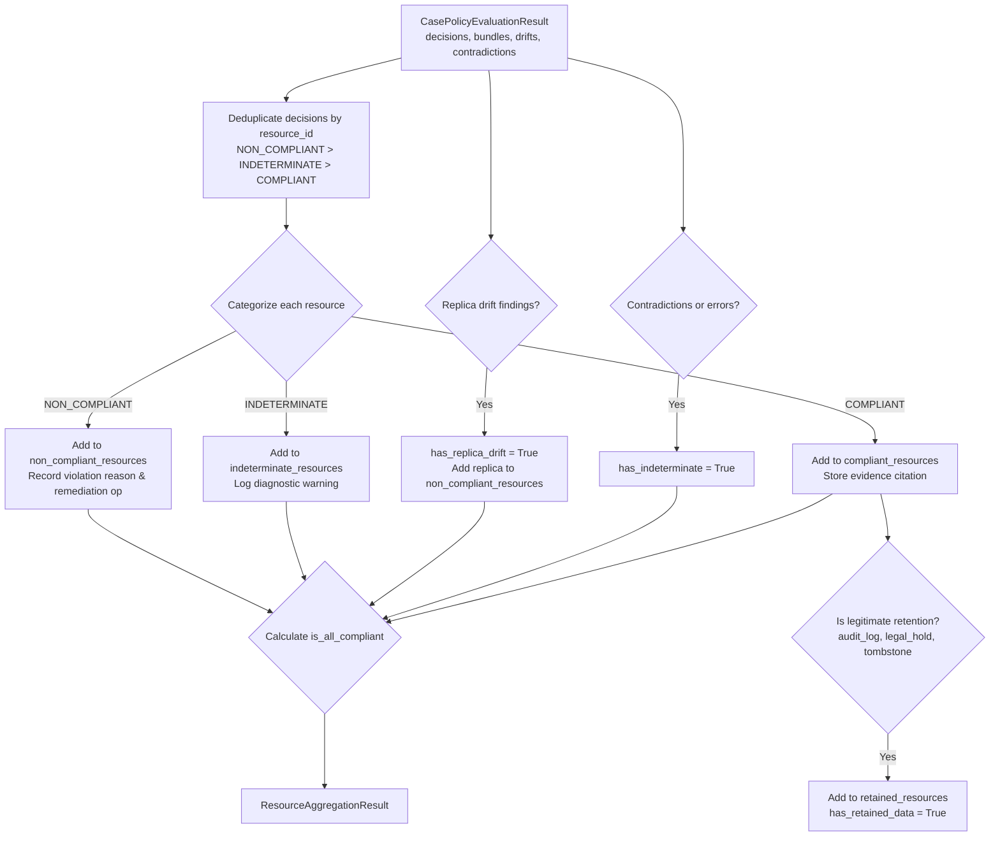

# Phase 7 — Chunk 7.3 Implementation Report
## Resource Compliance Aggregation

**Date:** 2026-10-25  
**Engineer:** Principal Backend & Policy-Engine Engineer  
**Harness:** Antigravity IDE  
**Model:** Gemini 3.8 Flash (Medium)  
**Target Repository:** HackerRank Orchestrate (October 2026) — *Ghost Data Still Exists*  
**Module Created:** `code/status/aggregator.py`, `code/status/test_aggregator.py`

---

### 1. Executive Summary

Chunk 7.3 implements the **Resource Compliance Aggregator** (`ResourceComplianceAggregator`), the component in Phase 7 responsible for synthesizing all Phase 6 resource-level policy evaluation decisions (`CasePolicyEvaluationResult`) into an aggregated, case-level compliance assessment (`ResourceAggregationResult`).

#### Core Engineering Guarantees:
1. **Zero False Compliances (Strict Conjunctive Compliance):** A single compliant resource cannot make a case complete. If even one resource is `NON_COMPLIANT`, `INDETERMINATE`, affected by confirmed replica drift, or marred by unresolved contradictions, `is_all_compliant` is strictly `False`.
2. **Explicit Evidence and Remediation Provenance:** The aggregator correlates each resource decision with its governing policy rule (`rule_id_by_resource`), participant-visible evidence proving state at cutoff (`evidence_provenance_by_resource`), and required future remediation operation (`remediations_required_by_resource`).
3. **Legitimate Retention Protection:** Legitimate retained records (`SECURITY_AUDIT_LOG` within retention periods, `LEGAL_HOLD_RECORD` under active hold, and compliant `ACCOUNT_TOMBSTONE` with stable reference preserved) are isolated into `retained_resources` and marked `has_retained_data=True` without triggering false violations.
4. **Deterministic Deduplication:** Duplicate references to the same resource ID are resolved deterministically: `NON_COMPLIANT` takes priority, followed by `INDETERMINATE`, then `COMPLIANT`.
5. **No Premature Status Assignment:** Conforming to the Phase 7 architectural plan, Chunk 7.3 does not assign the final `deletion_status` or emit final output rows; it supplies the structured compliance evidence needed by subsequent risk-assessment and status-resolution chunks.

---

### 2. Result Schema (`ResourceAggregationResult`)

Defined in `code/status/models.py`:

```python
@dataclass(frozen=True)
class ResourceAggregationResult:
    case_id: str
    total_resources: int
    is_all_compliant: bool
    has_violations: bool
    has_indeterminate: bool
    has_retained_data: bool
    has_replica_drift: bool
    compliant_resources: list[str] = field(default_factory=list)
    non_compliant_resources: list[str] = field(default_factory=list)
    indeterminate_resources: list[str] = field(default_factory=list)
    retained_resources: list[str] = field(default_factory=list)
    evidence_provenance_by_resource: dict[str, str] = field(default_factory=dict)
    violations_by_resource: dict[str, str] = field(default_factory=dict)
    remediations_required_by_resource: dict[str, str] = field(default_factory=dict)
    rule_id_by_resource: dict[str, str] = field(default_factory=dict)
    contradictions: list[str] = field(default_factory=list)
    upstream_errors: list[str] = field(default_factory=list)
    diagnostics: list[str] = field(default_factory=list)
```

---

### 3. Aggregation Rules & State Disambiguation



1. **Proven Compliance:**
   - Resource has `compliance_result == ComplianceResult.COMPLIANT`.
   - Evidence citation preserved in `evidence_provenance_by_resource`.
2. **Proven Violation:**
   - Resource has `compliance_result == ComplianceResult.NON_COMPLIANT`.
   - Primary reason stored in `violations_by_resource`.
   - Remediation action (`DELETE_RECORD`, `REDACT_RECORD`, `ANONYMIZE_RECORD`, `DISABLE_DATA_FLOW`, `BLOCK_RESTORE`) mapped into `remediations_required_by_resource`.
3. **Indeterminate State / Missing Evidence:**
   - Resource has `compliance_result in (INDETERMINATE, NOT_APPLICABLE)` or missing required evidence.
   - Preserved in `indeterminate_resources`, forcing `has_indeterminate=True` and `is_all_compliant=False`.
4. **Contradictions:**
   - Any temporal discrepancy ($T_{\text{event}} > T_{\text{capture}}$) or claim-vs-evidence conflict flagged upstream forces `has_indeterminate=True` and `is_all_compliant=False`.
5. **Replica Drift:**
   - When primary is deleted but replica retains personal data, the replica is placed into `non_compliant_resources`, setting `has_replica_drift=True`, `has_violations=True`, and `is_all_compliant=False`.

---

### 4. Test Execution & Verification

1. **Focused Status Tests:**
   - **Command:** `.venv/bin/pytest code/status/ -v`
   - **Result:** `23 passed in 0.05s` (exit code `0`)
   - **New Tests in `test_aggregator.py`:**
     - `test_01_multiple_compliant_resources`: All resources compliant $\to$ `is_all_compliant=True`, `has_retained_data=True`.
     - `test_02_mixed_compliant_and_non_compliant`: Proves a single compliant resource cannot make a case compliant when violations exist.
     - `test_03_indeterminate_missing_evidence`: Unverified/indeterminate resource correctly flags `has_indeterminate=True`.
     - `test_04_contradictory_evidence_propagation`: Conflicting evidence citations invalidate `is_all_compliant`.
     - `test_05_valid_retention_exceptions`: Compliant tombstone and security audit record recognized as legitimate retention.
     - `test_06_duplicate_resource_references`: Duplicate decisions resolved deterministically with `NON_COMPLIANT` precedence.
     - `test_07_empty_resource_collection`: Zero resources handled cleanly with diagnostics without crashing.
     - `test_08_replica_drift_detection`: Replica drift surfaced as a non-compliant resource violation.
     - `test_09_remediations_required_mapping`: Maps non-compliant resources to required remediation actions.
     - `test_10_repeat_run_determinism`: 50 repeat runs produce bit-identical outputs.

---

### 5. Completion Gate Sign-Off

- [x] Resource compliance aggregation is fully deterministic and evidence-grounded.
- [x] Strict conjunctive compliance enforced: single compliant record cannot override remaining violations.
- [x] Proven violations, proven compliance, retentions, and unverified states strictly separated.
- [x] Evidence citations and policy rule IDs preserved.
- [x] 100% of tests passing with zero failures.

**Status:** `CHUNK 7.3 COMPLETE — READY FOR CHUNK 7.4`
