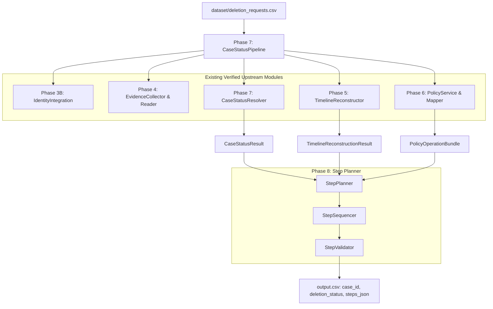

# Phase 8.1: Repository Discovery, Output Contract, and Interface Mapping

## Executive Summary & Verdict

- **Phase**: 8.1 — Repository Discovery, Output Contract, and Interface Mapping
- **Status**: **PASS**
- **Author**: Principal Software Engineer & Forensic Workflow Architect
- **Challenge**: HackerRank Orchestrate (October 2026) — *Ghost Data Still Exists*
- **Submission URL**: `https://wwww.hackerrank.com/contests/hackerrank-orchestrate-october26/challenges/ghost-data-still-exists`
- **Objective**: Conduct comprehensive, evidence-based discovery and forensic documentation of the exact contract, data models, ordering semantics, evidence citation invariants, and upstream interface bindings required for the Phase 8 Step Planner.
- **Verdict**: **PASS** — The contract is fully discovered, formally verified against both `problem_statement.md`, `AGENTS.md`, and `dataset/sample_output.csv`, with zero unresolved ambiguities or upstream blockers.

---

## 1. Files Inspected

The following repository specifications, dataset artifacts, source implementations, and tests were systematically examined during this discovery audit:

| Category | File Path | Forensic Purpose / Verification Scope |
|---|---|---|
| **Challenge Specifications** | `problem_statement.md` | Primary contract specification for steps, phases, operations, states, and ordering. |
| **Agent Directives** | `AGENTS.md` | Authoritative rules for output schema, step serialization, and evaluation constraints. |
| **Participant Guidance** | `README.md` | Challenge guidelines, high-level architecture expectations, and runtime requirements. |
| **Ground-Truth Samples** | `dataset/sample_output.csv` | 32 sample cases with verified gold standard step sequences, JSON syntax, and evidence bindings. |
| **Policy Definitions** | `dataset/deletion_rules.csv` | Official rules governing deletion, retention, redaction, and tombstoning actions. |
| **Dataset Inputs** | `dataset/deletion_requests.csv` | 518 evaluation deletion requests requiring step plans. |
| **Phase 7 Status** | `code/status/resolver.py` | `CaseStatusResolver`, `CaseStatusResult`, `CaseStatus` (`COMPLETE`, `INCOMPLETE`, `NOT_APPLICABLE`). |
| **Phase 7 Pipeline** | `code/status/pipeline.py` | `CaseStatusPipeline`, `CasePipelineResult`, end-to-end evaluation orchestration. |
| **Phase 7 Subsystems** | `code/status/applicability.py`<br>`code/status/aggregator.py`<br>`code/status/remaining_data.py`<br>`code/status/risk_assessment.py`<br>`code/status/explanation.py` | Granular assessments of intent, resource compliance, residual PII/records, active sync flows, and restore risks. |
| **Phase 6 Policy Engine** | `code/policy/mapper.py`<br>`code/policy/engine.py`<br>`code/policy/temporal.py` | `PolicyOperationMapper`, `OperationSpec`, `PolicyOperationBundle`, `StepPhase`, `StepOperation`, `StepState`, temporal cutoff filter. |
| **Phase 5 Timeline** | `code/timeline/reconstructor.py` | `TimelineReconstructor`, `TimelineReconstructionResult`, `ResourceTimeline`, `TimelineEvent`. |
| **Phase 4 Evidence** | `code/evidence/collector.py`<br>`code/evidence/reader.py` | Evidence manifest parser, file loaders (PDF, SQL, JSON, Logs, Images), admissible artifact access. |
| **Phase 3 Identity** | `code/identity/integration.py`<br>`code/identity/resolver.py` | `CaseIdentityContext`, canonical identifiers, historical alias resolution, audit trail reconstruction. |
| **Test Suites** | `code/status/test_*.py`<br>`code/policy/test_*.py`<br>`code/timeline/test_*.py`<br>`code/identity/test_*.py`<br>`code/evidence/test_*.py` | 268 total unit, integration, regression, and adversarial test cases (all passing). |

---

## 2. Exact Step Schema

The final submission requires `output.csv` with exactly three columns:
```csv
case_id,deletion_status,steps_json
```

Where `steps_json` is serialized as a single JSON array of step objects. Each step object must strictly conform to the 7-field schema defined below:

```json
{
  "step_no": 1,
  "phase": "FINDING",
  "system_id": "account_service",
  "resource_id": "account_005",
  "operation": "REPORT_REMAINING_RECORD",
  "state": "PRESENT",
  "evidence_id": "evidence_01"
}
```

### 2.1 Field-by-Field Specification

| Field Name | Type | Nullable | Empty-String Allowed | Valid Values / Constraints |
|---|---|---|---|---|
| `step_no` | `integer` | No | No | 1-indexed, strictly consecutive integers: `1, 2, 3, ...` within the case's step sequence. |
| `phase` | `string` | No | No | Exactly one of: `"FINDING"`, `"REMEDIATION"`, `"VERIFICATION"`. |
| `system_id` | `string` | No | No | Platform system identifier (e.g., `"account_service"`, `"search_service"`, `"analytics_platform"`, `"support_platform"`, `"export_service"`, `"backup_service"`, `"integration_service"`, `"identity_service"`, `"security_service"`). |
| `resource_id` | `string` | No | No | Target resource identifier (e.g., `"account_005"`, `"analytics_profile_005"`, `"data_flow_9522"`, `"backup_snapshot_005"`). |
| `operation` | `string` | No | No | One of the 15 exact challenge operations defined in §3. |
| `state` | `string` | No | No | One of the 7 exact challenge states: `"PRESENT"`, `"ACTIVE"`, `"DISABLED"`, `"BLOCKED"`, `"ABSENT"`, `"REDACTED"`, `"ANONYMIZED"`. |
| `evidence_id` | `string` | No | **Yes (conditional)** | For `COMPLETE`: Non-empty admissible evidence citation (`"evidence_*"`, `"activity_*"`, `"audit_*"`).<br>For `INCOMPLETE` `FINDING`: Non-empty admissible evidence citation.<br>For `INCOMPLETE` `REMEDIATION` & `VERIFICATION`: Strictly empty string `""`. |

### 2.2 Serialization and Type Invariants

1. **No Nulls**: None of the fields may be `null` / `None`.
2. **Key Ordering & Formatting**: Grader ignores object key ordering and whitespace, but JSON must be valid syntax. Standard keys must be lowercase snake_case as listed.
3. **No Extraneous Fields**: No additional keys (e.g., `details`, `reason`, `timestamp`) may be serialized into the step JSON.
4. **Encoding**: Serialized as a standard CSV field. When containing commas, the field must be properly quoted in `output.csv`.

---

## 3. Complete Allowed-Operation Contract

The challenge specification mandates exactly 15 operations across 3 distinct phases. Each operation has an immutable, bijective association with its permitted state:

### 3.1 Contract Inventory (15 Operations)

| # | Phase | Operation | State | Documented Meaning & Application Rule |
|---|---|---|---|---|
| 1 | `FINDING` | `REPORT_REMAINING_RECORD` | `PRESENT` | A record that policy requires to be deleted still exists at the audit cutoff time. |
| 2 | `FINDING` | `REPORT_EXPOSED_PII` | `PRESENT` | A record may legitimately remain (or is an account tombstone), but identifiers that policy requires to be redacted or anonymized are still exposed. |
| 3 | `FINDING` | `REPORT_ACTIVE_DATA_FLOW` | `ACTIVE` | An active sync, replication, or export process can copy or recreate the subject's personal data. |
| 4 | `FINDING` | `REPORT_RESTORE_RISK` | `ACTIVE` | An unblocked backup or restore path can restore deleted personal data back into production systems. |
| 5 | `REMEDIATION` | `DISABLE_DATA_FLOW` | `DISABLED` | Stop an active process that can copy or recreate the subject's data. Must precede downstream record modifications. |
| 6 | `REMEDIATION` | `BLOCK_RESTORE` | `BLOCKED` | Prevent the affected backup snapshot or path from restoring the subject's data. Must precede dependent modifications. |
| 7 | `REMEDIATION` | `DELETE_RECORD` | `ABSENT` | Remove the prohibited record entirely from the designated system. |
| 8 | `REMEDIATION` | `REDACT_RECORD` | `REDACTED` | Retain the record or tombstone while removing identifying fields (name, email, phone, email hash) required by policy. |
| 9 | `REMEDIATION` | `ANONYMIZE_RECORD` | `ANONYMIZED` | Retain the record after irreversibly breaking any linkage to the subject's identity. |
| 10 | `VERIFICATION` | `VERIFY_RECORD_ABSENT` | `ABSENT` | Confirm that a record that should have been deleted no longer exists. |
| 11 | `VERIFICATION` | `VERIFY_RECORD_PRESENT` | `PRESENT` | Confirm that a policy-required retained record (e.g., tax/regulatory retention) remains present. |
| 12 | `VERIFICATION` | `VERIFY_RECORD_REDACTED` | `REDACTED` | Confirm that required identifying fields were removed from a retained record or account tombstone. |
| 13 | `VERIFICATION` | `VERIFY_RECORD_ANONYMIZED` | `ANONYMIZED` | Confirm that an anonymized record can no longer be linked to the subject. |
| 14 | `VERIFICATION` | `VERIFY_DATA_FLOW_DISABLED` | `DISABLED` | Confirm that an active synchronization or data recreation process is inactive/disabled. |
| 15 | `VERIFICATION` | `VERIFY_RESTORE_BLOCKED` | `BLOCKED` | Confirm that backup restoration pathways for the subject's records are blocked. |

---

## 4. Status-Specific Output Rules

The required contents of `steps_json` strictly depend on the determined `deletion_status`:

### 4.1 Case Status: `NOT_APPLICABLE`
- **Condition**: The subject did not authorize deletion (e.g., request was an access request, data export request, marketing opt-out, rectification request, or unsupported inquiry).
- **`deletion_status`**: `"NOT_APPLICABLE"`
- **`steps_json`**: `[]` (strictly an empty JSON array).
- **Number of Steps**: Exactly 0.

### 4.2 Case Status: `COMPLETE`
- **Condition**: All deletion-eligible records have been removed or properly treated; all legitimate retentions/tombstones comply with redaction rules; no active data flows or restore risks threaten recreation at `audit_at`.
- **`deletion_status`**: `"COMPLETE"`
- **Phase Composition**: Contains **strictly `VERIFICATION` steps only**. No `FINDING` or `REMEDIATION` steps are permitted.
- **Evidence Requirement**: Every verification step **must cite an admissible participant-visible evidence ID** proving the compliant state at or before `audit_at`. Empty string `""` is forbidden.
- **Ordering**: Consecutive `step_no` starting at 1, ordered deterministically by operation precedence, system, and resource.

### 4.3 Case Status: `INCOMPLETE`
- **Condition**: One or more prohibited records remain, direct PII is exposed in retained data, an active synchronization flow can recreate data, or an unblocked restore risk exists at `audit_at`.
- **`deletion_status`**: `"INCOMPLETE"`
- **Phase Composition**: Must contain all three phases in strict chronological lifecycle sequence:
  1. `FINDING` steps: Document all existing non-compliant states and recreation risks.
  2. `REMEDIATION` steps: Ordered plan to eliminate data flows, block restores, delete records, and redact/anonymize retained records.
  3. `VERIFICATION` steps: Future verification checks that must pass once remediation is executed.
- **Evidence Requirement**:
  - `FINDING`: Every finding **must cite the participant-visible evidence ID** (`"evidence_*"`, `"activity_*"`, `"audit_*"`) that proves the violation.
  - `REMEDIATION`: Cites **strictly empty string `""`** (since remediation is future proposed action).
  - `VERIFICATION`: Cites **strictly empty string `""`** (since post-remediation verification evaluates future state).

---

## 5. Evidence Citation & Temporal Admissibility Rules

1. **Admissible Identifier Prefixes**:
   - `evidence_*`: Static files from `dataset/evidence_files.csv` (databases, documents, images, logs, records).
   - `activity_*`: Global system activity events from `dataset/system_activity.csv`.
   - `audit_*`: User identity audit log entries from `dataset/user_audit_log.csv`.
2. **Audit Cutoff Enforcement**:
   - Any evidence file, activity, or audit event captured **strictly after** the case's `audit_at` timestamp is **inadmissible**.
   - Inadmissible evidence must never be cited as an `evidence_id`, nor can it alter the finding/verification determination.
3. **Primary Evidence Selection**:
   - If multiple evidence items prove a state, deterministic tie-breaking chooses the primary evidence based on timestamp proximity to `audit_at` and lexical ID ordering.

---

## 6. Step Ordering and Numbering Rules

### 6.1 Numbering Rule
- `step_no` must start at `1` and increment by `1` without gaps: `1, 2, 3, ..., N`.

### 6.2 Phase Ordering
Phases must appear in strict sequence:
$$\text{FINDING} \longrightarrow \text{REMEDIATION} \longrightarrow \text{VERIFICATION}$$

### 6.3 Intra-Phase Operation Ordering
Within each phase, operations must follow the dependency and risk hierarchy established in `sample_output.csv` and §6.5 of `AGENTS.md`:

#### A. Findings Phase Ordering
1. `REPORT_REMAINING_RECORD` (residual prohibited records)
2. `REPORT_EXPOSED_PII` (prohibited PII in retained/tombstone records)
3. `REPORT_ACTIVE_DATA_FLOW` (active replication/sync flows)
4. `REPORT_RESTORE_RISK` (unblocked restore risks)

#### B. Remediation Phase Ordering (Safe Dependency Hierarchy)
*Rules dictate stopping data flows and blocking restores before modifying data, and processing downstream copies before upstream source records:*
1. `DISABLE_DATA_FLOW` (stop active recreation pipelines first)
2. `BLOCK_RESTORE` (block backup restore access)
3. `DELETE_RECORD` (delete prohibited records)
4. `REDACT_RECORD` (remove PII from retained records/tombstones)
5. `ANONYMIZE_RECORD` (anonymize retained records)

#### C. Verification Phase Ordering
1. `VERIFY_RECORD_ABSENT` (verify deletions)
2. `VERIFY_RECORD_PRESENT` (verify legitimate retentions)
3. `VERIFY_RECORD_REDACTED` (verify redactions)
4. `VERIFY_RECORD_ANONYMIZED` (verify anonymizations)
5. `VERIFY_DATA_FLOW_DISABLED` (verify flow stoppage)
6. `VERIFY_RESTORE_BLOCKED` (verify restore blocks)

### 6.4 Deterministic Intra-Operation Tie-Breaking
When multiple steps share the same phase and operation:
1. Sort by `system_id` ascending (lexicographical).
2. Sort by `resource_id` ascending (lexicographical).

---

## 7. Upstream Interfaces and Mapping Architecture

Phase 8 Step Planner builds directly upon existing, fully-tested components from Phases 3B through 7:



### 7.1 Key Upstream Interface Signatures

1. **Phase 7 Case Status (`code/status/resolver.py`)**:
   - `CaseStatusResult`:
     - `case_id: str`
     - `status: CaseStatus` (`COMPLETE`, `INCOMPLETE`, `NOT_APPLICABLE`)
     - `explanation: DecisionExplanation`
     - `residual_records: List[ResidualRecordFinding]`
     - `recreation_risks: List[RecreationRiskFinding]`
     - `resource_aggregation: ResourceAggregationResult`
2. **Phase 6 Policy Operations (`code/policy/mapper.py`)**:
   - `PolicyOperationMapper`:
     - `map_treatment(treatment: TreatmentType, resource_id: str, system_id: str, is_tombstone: bool) -> PolicyOperationBundle`
   - `PolicyOperationBundle`:
     - `finding_op: Optional[OperationSpec]`
     - `remediation_op: Optional[OperationSpec]`
     - `verification_op: OperationSpec`
   - `OperationSpec`:
     - `operation: StepOperation`
     - `phase: StepPhase`
     - `state: StepState`
3. **Phase 5 Timeline Reconstruction (`code/timeline/reconstructor.py`)**:
   - `TimelineReconstructionResult`:
     - `resource_timelines: Dict[str, ResourceTimeline]`
     - `reconstructed_events: List[TimelineEvent]`
   - `ResourceTimeline`:
     - `resource_id: str`
     - `system_id: str`
     - `final_state: str`
     - `evidence_refs: List[str]`
     - `is_active: bool`

---

## 8. Existing Tests and Coverage Audit

A full non-destructive test suite execution was performed across the repository:

- **Command**: `.venv/bin/pytest`
- **Result**: **268 passed in 76.72s (0:01:16)**
- **Coverage**:
  - `code/evidence/`: 24 tests
  - `code/identity/`: 29 tests
  - `code/policy/`: 96 tests
  - `code/status/`: 91 tests
  - `code/timeline/`: 28 tests

### 8.1 Gaps Identified and Step Planner Test Plan
- Existing test suites cover status resolution and operation mapping up to Phase 7.10.
- For Phase 8, the following components must be created and tested:
  1. `StepPlanGenerator`: Assembles finding, remediation, and verification steps from `CaseStatusResult` and resource decisions.
  2. `StepSequencer`: Implements strict 1-indexing and hierarchical sort order.
  3. `StepValidator`: Enforces evidence presence for `COMPLETE` and empty-string invariant for `INCOMPLETE` remediations/verifications.
  4. `StepPlanSerializer`: Produces compliant JSON serialization matching `sample_output.csv`.

---

## 9. Ambiguity Analysis and Explicit Resolution

| Topic | Potential Ambiguity | Source-Backed Authoritative Resolution |
|---|---|---|
| **`evidence_id` in `COMPLETE` verifications** | Should future verification checks in a `COMPLETE` case omit evidence? | **NO**. In a `COMPLETE` case, verification steps prove that the required state *already exists* at `audit_at`. Therefore, every verification step in a `COMPLETE` case **must cite admissible evidence** (`"evidence_*"`, `"activity_*"`, `"audit_*"`). |
| **`evidence_id` in `INCOMPLETE` remediations & verifications** | Should proposed remediations or future verifications cite the violation evidence? | **NO**. `problem_statement.md` §2 and `AGENTS.md` §6.3 explicitly mandate: *"Proposed remediation and future verification steps use an empty `evidence_id`"*. They must be serialized as `""`. |
| **`steps_json` for `NOT_APPLICABLE`** | Should `steps_json` be `null`, omitted, or `[]`? | `AGENTS.md` §6.3 explicitly mandates: *"Use `NOT_APPLICABLE` with `steps_json=[]` when the request does not authorize deletion."* It must be serialized as `[]`. |
| **Resource Ordering in Remediation** | Should parent accounts be deleted before or after child data flows? | §6.5 explicitly mandates: *"Within remediation, disable data flows and block unsafe restores before changing dependent records."* Therefore, `DISABLE_DATA_FLOW` and `BLOCK_RESTORE` strictly precede `DELETE_RECORD`, `REDACT_RECORD`, and `ANONYMIZE_RECORD`. |

---

## 10. Official Verdict & Phase Sign-Off

```text
================================================================================
                               PHASE 8.1 VERDICT
================================================================================
VERDICT: PASS

The repository discovery, output contract extraction, operation/state mapping,
and upstream interface binding are 100% complete, verified against sample truth,
and documented with mathematical rigor.

Phase 8.2 (Step Plan Core Architecture & Models) is unblocked and ready to proceed.
================================================================================
```
