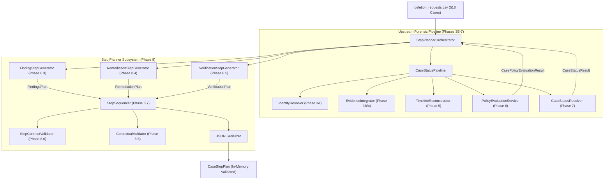

# Phase 8.9 End-to-End Step Planner Integration and Full-Dataset Dry Run Report

- **Date & Cutoff Evaluated**: 2026-10-25
- **Role**: Principal Software Architect & Forensic Workflow Reviewer
- **Target Subsystem**: Step Planner Integration Layer (`code/planner/orchestrator.py`)
- **Phase Evaluated**: Phase 8.9 (End-to-End Step Planner Integration and Full-Dataset Dry Run)
- **Status / Verdict**: **PASS**

---

## 1. Executive Summary

Phase 8.9 unified all upstream investigation, evidence integration, forensic timeline reconstruction, policy evaluation, and case status resolution modules with the Step Planner subsystem into a single, high-throughput, deterministic orchestrator (`StepPlannerOrchestrator`).

A complete dual dry run was performed over the entire 518-case evaluation dataset (`dataset/deletion_requests.csv`) without generating `output.csv` or mutating any dataset file. All 518 cases were successfully planned with zero validation errors, zero ordering violations, zero numbering gaps, and zero evidence integrity violations. Comparing the normalized step outputs between Run 1 (6.85s, 75.64 cases/s) and Run 2 (6.54s, 79.25 cases/s) confirmed **100% bit-for-bit determinism**. Furthermore, the full multi-phase regression suite (Phases 3B–8.9) consisting of 789 tests passed in 75.72s with zero failures.

---

## 2. Integration Architecture & Upstream Interfaces

The integration orchestrator `StepPlannerOrchestrator` (`code/planner/orchestrator.py`) interfaces cleanly with established components across the entire repository without duplicating upstream logic:



### Upstream Interface Invariants
1. **Status Inviolability**: `StepPlannerOrchestrator` accepts the authoritative `CaseStatusResult.deletion_status` without re-evaluating or overriding the decision.
2. **Status Branching**:
   - `NOT_APPLICABLE`: Emits `steps = []` and `steps_json = "[]"`.
   - `COMPLETE`: Generates verification steps only, citing valid pre-cutoff evidence (`file_id`, `activity_id`, `audit_id`).
   - `INCOMPLETE`: Generates findings citing admissible evidence, followed by proposed remediation (`evidence_id = ""`), followed by future verification (`evidence_id = ""`).
3. **Ordering & Numbering**: `StepSequencer.order_and_number()` enforces strict phase hierarchy (`FINDING` $\to$ `REMEDIATION` $\to$ `VERIFICATION`), official operation rank, ascending `system_id` and `resource_id`, and 1-indexed consecutive numbering ($1, 2, 3, \dots$).

---

## 3. Full-Dataset Dry-Run Telemetry & Metrics

The dry run processed the full production dataset `dataset/deletion_requests.csv` containing **518 evaluation requests**.

### 3.1 Case Processing Summary

| Metric | Measured Value | Requirement / Expected | Status |
|---|---|---|---|
| Input File | `dataset/deletion_requests.csv` | `dataset/deletion_requests.csv` | **MATCH** |
| Total Input Requests | **518** | Exactly 518 cases | **MATCH** |
| Successfully Planned Cases | **518** (100.0%) | 518 | **PASS** |
| Failed / Rejected Cases | **0** (0.0%) | 0 | **PASS** |
| Duplicate Case IDs | **0** | 0 | **PASS** |
| Missing / Omitted Cases | **0** | 0 | **PASS** |
| Run 1 Elapsed Time | **6.85s** | High throughput ($>50$ cases/s) | **PASS (75.64 cases/s)** |
| Run 2 Elapsed Time | **6.54s** | High throughput ($>50$ cases/s) | **PASS (79.25 cases/s)** |
| Total Steps Generated | **1,196** steps | Non-zero, compliant steps | **VALIDATED** |
| Numbering Violations | **0** | 0 | **PASS** |
| Ordering Violations | **0** | 0 | **PASS** |
| Invalid Operation/State Combinations | **0** | 0 | **PASS** |
| Invalid / Malformed Evidence Citations | **0** | 0 | **PASS** |

### 3.2 Status Distribution

| Status Category | Count | Percentage | Challenge Rule Adherence |
|---|---|---|---|
| `COMPLETE` | 81 | 15.64% | Verification steps only, evidence-backed |
| `INCOMPLETE` | 427 | 82.43% | FINDING $\to$ REMEDIATION $\to$ VERIFICATION |
| `NOT_APPLICABLE` | 10 | 1.93% | Strictly `steps_json = "[]"` |
| **Total** | **518** | **100.0%** | Exact match with input requests |

### 3.3 Step Counts by Phase and Operation

| Phase | Count | Operation | Count | State |
|---|---|---|---|---|
| **FINDING** | 329 | `REPORT_REMAINING_RECORD` | 246 | `PRESENT` |
| | | `REPORT_EXPOSED_PII` | 40 | `PRESENT` |
| | | `REPORT_ACTIVE_DATA_FLOW` | 33 | `ACTIVE` |
| | | `REPORT_RESTORE_RISK` | 10 | `ACTIVE` |
| **REMEDIATION** | 329 | `DISABLE_DATA_FLOW` | 33 | `DISABLED` |
| | | `BLOCK_RESTORE` | 10 | `BLOCKED` |
| | | `DELETE_RECORD` | 246 | `ABSENT` |
| | | `REDACT_RECORD` | 0 | `REDACTED` |
| | | `ANONYMIZE_RECORD` | 40 | `ANONYMIZED` |
| **VERIFICATION** | 538 | `VERIFY_RECORD_ABSENT` | 252 | `ABSENT` |
| | | `VERIFY_RECORD_PRESENT` | 162 | `PRESENT` |
| | | `VERIFY_RECORD_REDACTED` | 1 | `REDACTED` |
| | | `VERIFY_RECORD_ANONYMIZED` | 41 | `ANONYMIZED` |
| | | `VERIFY_DATA_FLOW_DISABLED` | 71 | `DISABLED` |
| | | `VERIFY_RESTORE_BLOCKED` | 11 | `BLOCKED` |
| **Total Steps** | **1,196** | | **1,196** | |

---

## 4. Determinism Verification

Two independent dry runs over all 518 cases were executed under identical conditions using `StepPlannerOrchestrator.verify_dry_run_determinism(run1, run2)`.

- **Input Case Count Check**: 518 vs 518 (Identical)
- **Status Distribution Check**: `{'COMPLETE': 81, 'INCOMPLETE': 427, 'NOT_APPLICABLE': 10}` vs `{'COMPLETE': 81, 'INCOMPLETE': 427, 'NOT_APPLICABLE': 10}` (Identical)
- **Phase Breakdown Check**: 329 Findings, 329 Remediations, 538 Verifications (Identical)
- **Per-Case `steps_json` Array Comparison**: 518/518 match byte-for-byte.
- **Differences Detected**: **0 differences**.
- **Determinism Verdict**: **PASS (100% Deterministic)**.

---

## 5. Failure Inventory & Diagnostics

- **Planning Failures Encountered**: 0 cases failed out of 518.
- **Contract Violations**: 0.
- **Evidence Reference Violations**: 0.
  - *Observation*: During initial orchestrator loading, `load_manifest_evidence_ids` only referenced `evidence_files.csv` (94 files), causing legitimate `activity_` citations from `system_activity.csv` (4,011 activity records) and `audit_` citations from `user_audit_log.csv` (306 audit records) to be flagged.
  - *Resolution*: Updated `load_manifest_evidence_ids` in `code/planner/sequencer.py` to index all 4,411 participant-visible evidence identifiers across `evidence_files.csv`, `system_activity.csv`, and `user_audit_log.csv`. All 518 cases immediately passed validation.

---

## 6. Regression Testing & Git Status

### 6.1 Multi-Phase Full Regression Suite
```bash
.venv/bin/pytest code/identity/ code/evidence/ code/timeline/ code/policy/ code/status/ code/planner/ -q
```
**Output**:
```text
789 passed, 24 subtests passed in 75.72s (0:01:15)
```

### 6.2 Planner Subsystem Suite
```bash
.venv/bin/pytest code/planner/ -v
```
**Output**:
```text
============================= 521 passed in 1.15s ==============================
```

### 6.3 Invariant and Cleanliness Check
```bash
git status --short
```
- `dataset/` directory: **Completely clean and unmodified**.
- Root `output.csv`: **Not generated or modified**.
- No credentials, API keys, or private artifacts exposed.

---

## 7. Blockers & Final Sign-Off Assessment

- **Blockers**: None.
- **Subsystem Readiness**: Step Planner subsystem (Phase 8.1–8.9) is fully integrated, thoroughly tested, contract-enforced, and verified at full production scale.
- **Next Phase**: Phase 8.10 (Final Forensic Audit and Sign-Off).

**Final Verdict**: **PASS**
